<div align="center">

[English](README.md) · **Español**

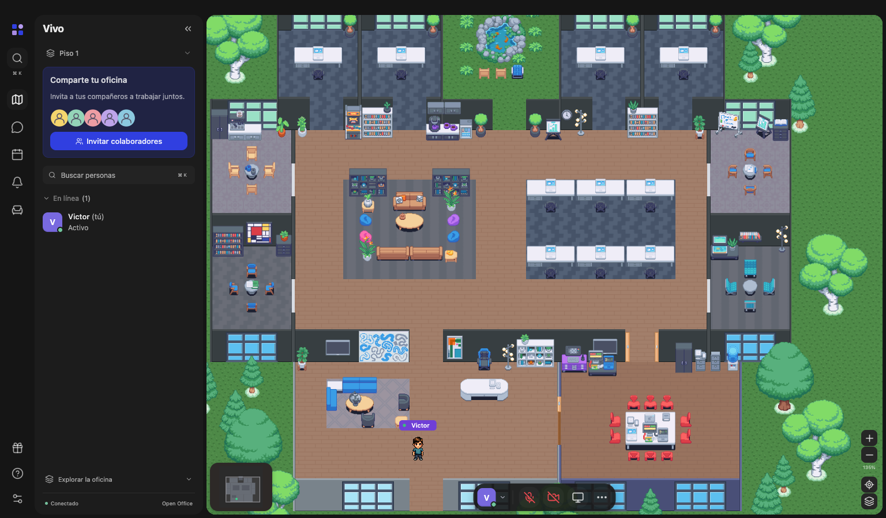

# 🌍 Open Office For All

**Una oficina virtual libre y de código abierto para todos los equipos del mundo.**

### [🌐 openofficeforall.app](https://openofficeforall.app)

[](https://openofficeforall.app)
[](LICENSE)
[](https://github.com/VictorSandovalDev/OpenOfficeForAll/actions/workflows/ci.yml)
[](#-inicio-rápido)
[](#%EF%B8%8F-arquitectura)
[](#-hecho-para-todo-el-mundo)
[](https://github.com/sponsors/VictorSandovalDev)
[](https://ko-fi.com/victorsandovaldev)

[🌐 Sitio web](https://openofficeforall.app) · [Por qué](#-por-qué-open-office-for-all) · [Inicio rápido](#-inicio-rápido) · [Funciones](#-funciones) · [Arquitectura](#%EF%B8%8F-arquitectura) · [Hoja de ruta](#%EF%B8%8F-hoja-de-ruta)

</div>

---

## ✨ Por qué Open Office For All

Los equipos remotos merecen un lugar donde *estar juntos*, no solo una lista de videollamadas. Open Office For All recrea la sensación de una oficina real en un acogedor mundo de píxeles: acércate a un compañero, siéntate en tu escritorio, entra en una sala de reuniones y cierra la puerta. Sin suscripciones, sin límite de puestos y sin depender de ningún proveedor. **Ejecútalo en tu propio equipo, en cualquier país y en cualquier idioma.**

El proyecto es una recreación fiel e independiente de la experiencia de las oficinas virtuales modernas. Está inspirado en Gather 2.0, no tiene relación con esa empresa y está hecho para que cualquiera pueda estudiarlo, alojarlo y mejorarlo.

---

🌐 **Sitio web:** [openofficeforall.app](https://openofficeforall.app), con un rincón jugable de la oficina en la portada.

## 🚀 Inicio rápido

```sh
git clone https://github.com/VictorSandovalDev/OpenOfficeForAll.git
cd OpenOfficeForAll
npm ci
npm run dev
```

Abre **http://127.0.0.1:5173**, escribe tu nombre y entra. Abre una segunda pestaña con otro nombre para ver la presencia, el chat y las reuniones funcionando a la vez. Ambas pestañas comparten la oficina cuando la dirección tiene el mismo valor de `?room=`.

> Necesita Node.js 22.18 o superior (comprobado con la versión 26.8). El servidor de tiempo real escucha en 127.0.0.1:3001.

**Ponla en internet para tu equipo:** la [guía de despliegue](docs/DEPLOY.es.md) configura HTTPS, clave de invitación, decoración solo para administradores y un servidor TURN con un solo `docker compose up`.

---

## 🧭 Funciones

<table>
<tr>
<td width="50%" valign="top">

### 🏢 Una oficina de verdad

Un mundo de 52 × 50 baldosas con recepción, escritorios de equipo, cinco salas de reunión, salas pequeñas y un jardín con estanque. Las paredes, las puertas, 203 muebles y 58 asientos están exactamente donde los pondría una oficina real, con el mismo modelo de colisiones.

</td>
<td width="50%" valign="top">

### 🚶 Muévete como si estuvieras allí

Flechas o WASD, Shift para ir más rápido y clic para caminar con rutas que respetan paredes y muebles. Haz clic en una silla o pulsa **E** para sentarte; el brazo de la silla queda delante de ti y los muros te ocultan cuando pasas detrás.

</td>
</tr>
<tr>
<td valign="top">

### 🔒 Salas de reunión que funcionan como tales

Pasa el ratón sobre una sala para ver su nombre y haz clic para abrir su tarjeta. **Iniciar reunión** te lleva a la silla más cercana a la mesa y las puertas se cierran. Si bloqueas la sala aparece un candado rojo en cada puerta. Comparte un enlace (`?meeting=<sala>`) que sienta a los invitados al llegar y cambia el nombre de la sala desde la tarjeta.

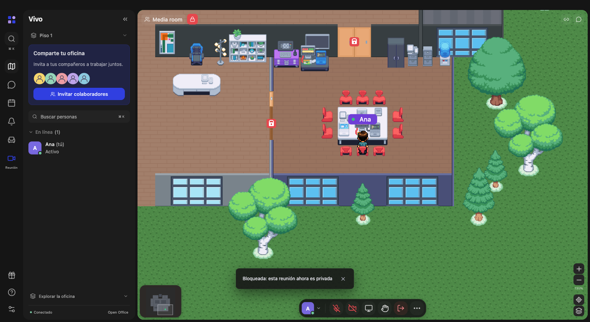

</td>
<td valign="top">

### 🎬 Vista de reunión completa

Cambia entre la oficina y una vista de reunión a pantalla completa: los participantes en mosaico con su cámara o su inicial, y paneles laterales con el chat de la reunión, las personas de la sala y los detalles.

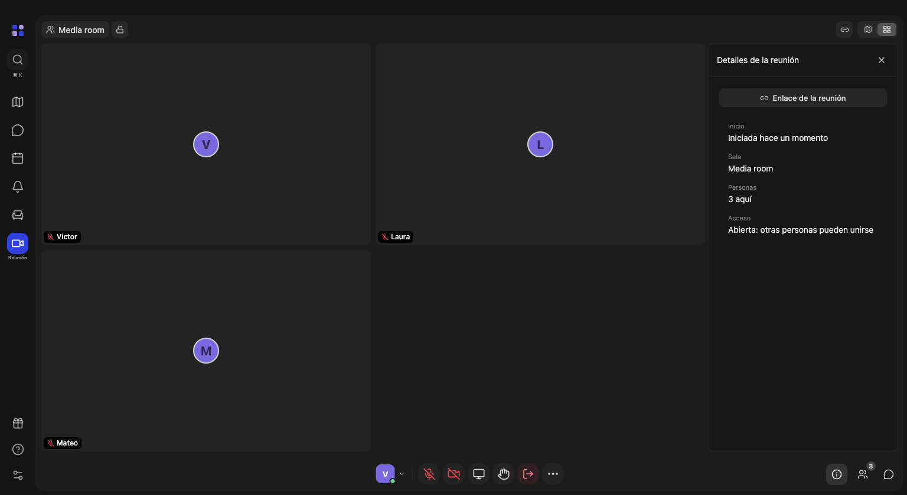

</td>
</tr>
<tr>
<td valign="top">

### 💬 Canales y mensajes directos

Chat al estilo de Slack: `#general`, `#social` y los canales que crees, mensajes directos privados, @menciones, formato (negrita, cursiva, listas, código, enlaces), borradores y avisos de no leídos. El historial se guarda en tu servidor. El chat cercano sigue llegando solo a quienes están a tu alrededor.

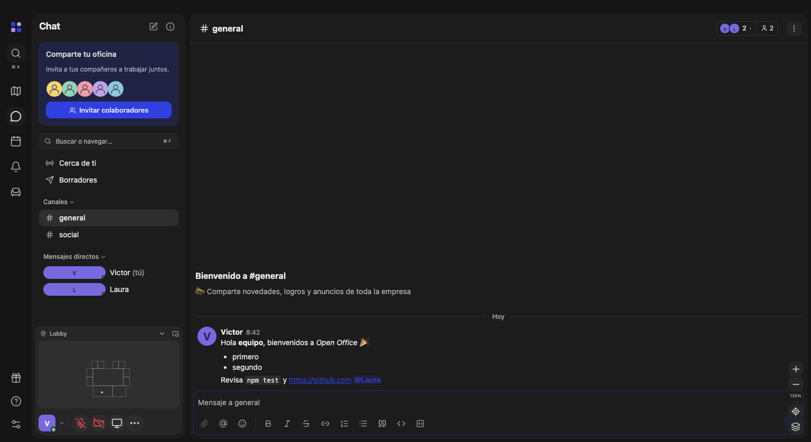

</td>
<td valign="top">

### 📅 Calendario y actividad

Un calendario semanal compartido por toda la oficina. Programa una reunión en una sala y todos la ven; **Unirse** te sienta en esa sala. La actividad reúne menciones, mensajes directos y reuniones que están por empezar.

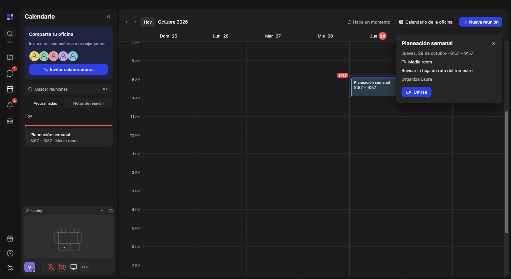

</td>
</tr>
<tr>
<td valign="top">

### 🛋️ Decora todo

Un catálogo de **81 objetos en 251 orientaciones**: escritorios, sillas, sofás, plantas, estanterías, lámparas y tecnología. Coloca, arrastra, gira (**R**), elimina y deshaz (**⌘ Z**), también los muebles originales. Lo que dejas sobre un escritorio queda encima, y el servidor valida cada colocación para que nadie quede atrapado.

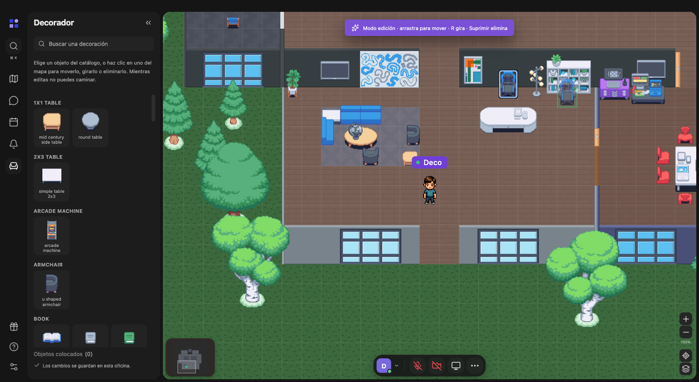

</td>
<td valign="top">

### 🧑‍🎨 Un avatar a tu medida

Elige un cuerpo masculino o femenino y después el color de piel, pelo, ropa y zapatos, gafas, sombreros, auriculares y vello facial. El pixel art conserva su sombreado en todas las poses y al caminar, y todos ven tu aspecto. Indica tu estado (Activo, Ocupado, Ausente) y un mensaje corto.

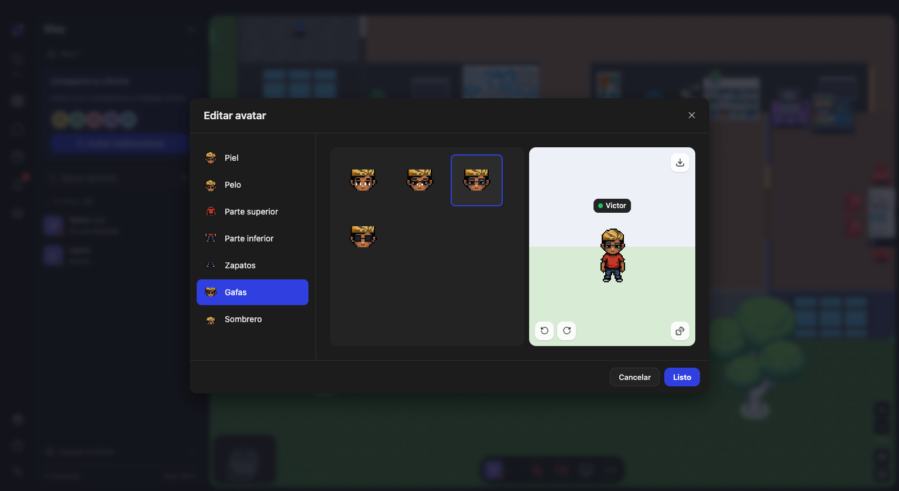

</td>
</tr>
<tr>
<td valign="top">

### 🗂️ Espacios para cada equipo

Crea todos los espacios que necesites, cada uno con su nombre, su mapa, sus personas, su chat, su calendario y sus escritorios. Los espacios nuevos salen como copia de tu oficina diseñada. El panel muestra los visitados, los que creaste y todos los del servidor, con quién está dentro ahora.

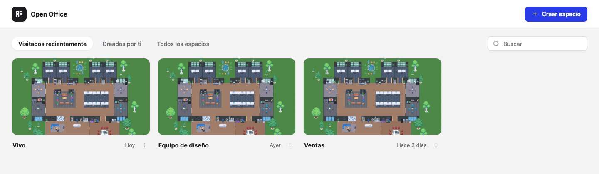

</td>
<td valign="top">

### 🪑 Escritorios, concentración y vista general

Entra a un escritorio para reclamarlo o asignárselo a alguien; ⌘ / Ctrl D te devuelve al tuyo. Las cuatro oficinas de arriba cierran su puerta mientras te concentras: los demás tocan y tú les dejas pasar. Aléjate con la rueda y la oficina pasa a una vista limpia de salas y personas.

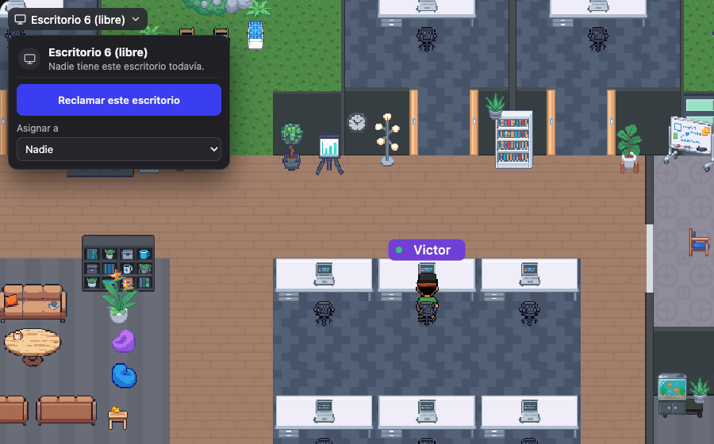

</td>
</tr>
<tr>
<td valign="top" colspan="2">

### 🎵 Reuniones para todo el equipo

Conecta un servidor de medios [LiveKit](https://livekit.io) opcional y las salas de reunión pasan a usarlo: cada persona envía su cámara una sola vez, así que una reunión de veinte va tan fluida como una de dos. Las conversaciones por cercanía siguen siendo entre pares. Dentro de una sala cualquiera puede poner **música tranquila para todos** (generada en el navegador y sincronizada para todos), **grabar el audio de la reunión** en un archivo con un aviso de *Grabando* visible para toda la sala, levantar la mano, enviar reacciones o sacar la llamada a una ventana emergente pequeña que queda siempre encima mientras trabajas en otra cosa.

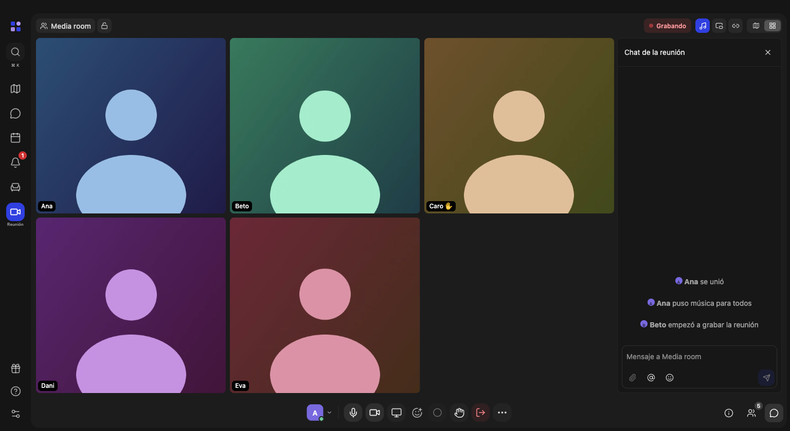

</td>
</tr>
</table>

Además: audio, vídeo y pantalla compartida con WebRTC (todo apagado al entrar), cuentas personales opcionales con contraseña, objetos interactivos que abren un enlace o una nota al pulsar **X** a su lado, espacios de trabajo con su propio nombre y mapa en tres tamaños (un Estudio junto al mar, la Oficina y un Campus de dos edificios con playa), amueblados como copia de tu oficina diseñada y renombrables desde el panel, escritorios asignados (⌘ / Ctrl D te lleva al tuyo), oficinas de concentración que te ponen en «No molestar» y cierran su puerta mientras estás dentro (los demás tocan y tú les dejas pasar), zoom con la rueda y una vista general de todos al alejarte, perfiles, temas claro, oscuro y del sistema, inglés y español, zoom del 36 % al 400 %, minimapa y atajos de teclado (⌘ / Ctrl K para buscar personas, ⌘ / Ctrl D para volver a tu escritorio).

---

## 🌐 Hecho para todo el mundo

- **Lo alojas tú.** Un solo proceso de Node ejecuta el servidor de tiempo real y el cliente son archivos estáticos. Tu oficina, tus datos, tu servidor.
- **Sin cuentas obligatorias.** Elige un nombre y un color y entra. Una sala es solo una palabra en la dirección. Activa las cuentas personales cuando tu equipo las necesite.
- **Abierto a todos los idiomas.** La interfaz está en inglés y en español, sigue el idioma del navegador y se cambia en Ajustes. Añadir un idioma es un solo archivo de diccionario en `src/i18n/`; las contribuciones con el tuyo son muy bienvenidas.
- **Abierto a todos los presupuestos.** Licencia MIT. Gratis para una startup de dos personas en Bogotá, un aula en Lagos o un equipo de voluntarios en Manila.
- **Abierto a todos los colaboradores.** Un código pequeño y legible: React y Vite en el cliente, un protocolo WebSocket documentado en el servidor, la geometría compartida en módulos ES sencillos y pruebas que fijan el comportamiento.

---

## 🏗️ Arquitectura

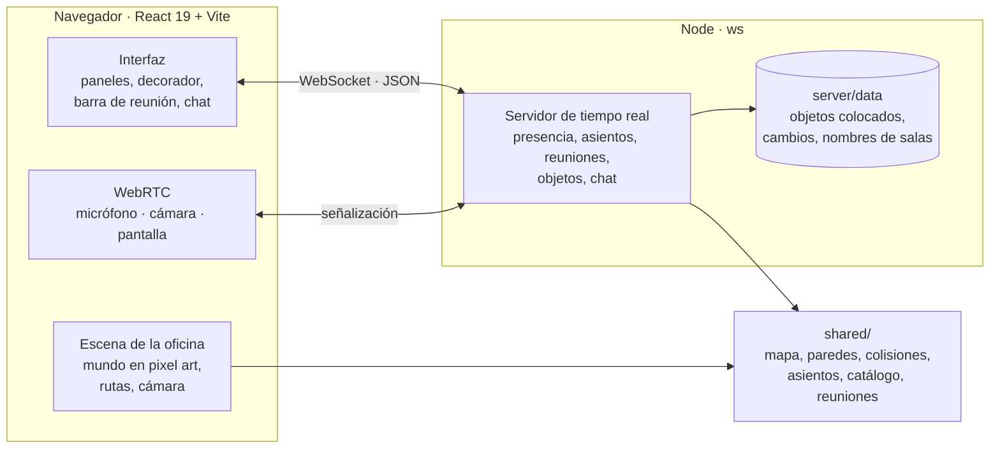

| Carpeta | Qué contiene |
| --- | --- |
| `src/` | Cliente React: escena, navegación, decorador, reuniones, chat y WebRTC |
| `server/` | Servidor de tiempo real y la [referencia de su protocolo](server/README.md) |
| `shared/` | Datos del mapa, geometría de paredes y colisiones, asientos, catálogo de objetos y utilidades de reunión que usan ambos lados |
| `public/assets/pixel/` | Animaciones del avatar y arte de píxeles generado, con notas de procedencia |
| `tests/` | Pruebas del servidor, asientos, colocación, reuniones y navegación |
| `docs/` | Notas de diseño y la [comparación detallada con la referencia](docs/COMPARACION-GATHER-2.md) |

---

## ✅ Verificación

```sh
npm test      # 54 pruebas: colisiones, asientos, colocación, reuniones, chat, cuentas, tokens de medios
npm run build # comprobación de tipos y paquete de producción
```

El modelo de colisiones se compara baldosa por baldosa con el mapa de referencia, las pruebas recorren 638 rutas entre asientos, y el bloqueo de reuniones, el chat de reunión y el cambio de nombre de salas se prueban de extremo a extremo con conexiones WebSocket reales.

---

## 🗺️ Hoja de ruta

- [x] Vista de reunión a pantalla completa con los participantes en mosaico
- [x] Canales de chat al estilo de Slack y mensajes directos
- [x] Calendario y actividad
- [x] Editor de avatar: colores de piel, pelo, ropa y zapatos, gafas y sombreros
- [x] Cuerpo femenino, vello facial y auriculares
- [ ] Más peinados y conjuntos
- [x] Interfaz en inglés y en español
- [ ] Más idiomas para la interfaz
- [x] Despliegue público: HTTPS, clave de invitación, rol de administrador, TURN, Docker
- [x] Cuentas personales con contraseña
- [ ] Inicio de sesión único
- [x] Servidor de medios (LiveKit) para reuniones grandes
- [x] Música para todos, grabación de reuniones y ventana emergente

¿Quieres alguna antes? Abre un issue o envía un pull request.

---

## ⚠️ Límites actuales

Las cuentas personales son opcionales (`ACCOUNTS=optional` o `required`); sin ellas, la identidad es el nombre que elige cada persona, protegido por las claves de invitación y de administrador. Todavía no hay inicio de sesión único. Sin servidor de medios las llamadas son entre pares, lo que funciona bien hasta unas ocho personas con cámara. La grabación guarda solo el audio, en el navegador de quien la inicia.

## 🎨 Arte y créditos

Todo el arte de este repositorio es original. Los avatares, los árboles, las plantas, el estanque y los muebles se generaron con [PixelLab](https://pixellab.ai) a partir de descripciones genéricas, usando las propias piezas del proyecto como guía de estilo, y algunos se dibujaron a mano; los suelos se dibujan por código. Los iconos son de [Lucide](https://lucide.dev) (ISC). No se incluye nada de ningún producto de terceros: ni código, ni sprites, ni credenciales.

Una oficina también puede usar su propio paquete de arte local en `src/sprites/reference/` (ignorado por git y nunca publicado). Si esa carpeta existe, la oficina lo usa automáticamente; si no, usa el arte anterior.

## 💜 Apoya el proyecto

Open Office For All es gratis y lo seguirá siendo. Si te sirve a ti o a tu equipo, puedes ayudar a que siga creciendo: nuevos mapas, muebles, avatares, idiomas y un servidor de demostración público.

<a href="https://github.com/sponsors/VictorSandovalDev"></a>
<a href="https://ko-fi.com/victorsandovaldev"></a>

Darle una estrella al repositorio y compartirlo con un equipo que trabaje en remoto también ayuda. ⭐

---

## 📄 Licencia

[MIT](LICENSE). Úsalo, modifícalo, publícalo y enseña con él.

<div align="center">

**Hecho con ❤️ para todos los equipos, en todas partes.**

</div>
