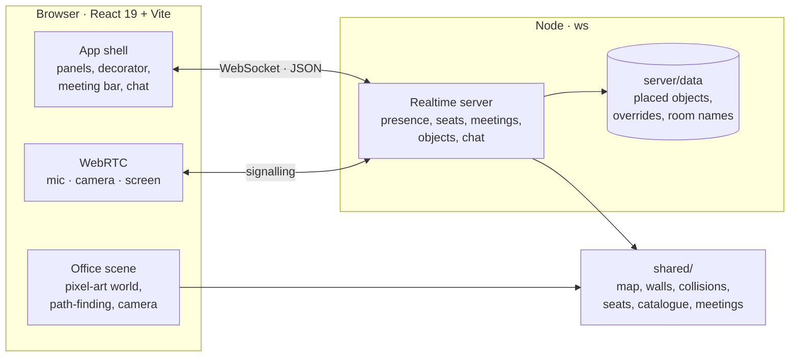

<div align="center">

**English** · [Español](README.es.md)


# 🌍 Open Office For All

**A free, open-source virtual office for every team on Earth.**

[](LICENSE)
[](https://github.com/VictorSandovalDev/OpenOfficeForAll/actions/workflows/ci.yml)
[](#-quick-start)
[](#-architecture)
[](#-built-for-the-whole-world)

[Why](#-why-open-office-for-all) · [Quick start](#-quick-start) · [Features](#-features) · [Architecture](#-architecture) · [Roadmap](#%EF%B8%8F-roadmap)

</div>

---

## ✨ Why Open Office For All

Remote teams deserve a place to *be together*, not just a list of video calls. Open Office For All recreates the feeling of a real office in a cosy pixel-art world: walk over to a colleague, sit down at a desk, step into a meeting room and close the door. No subscriptions, no seat limits, no vendor lock-in. **Run it on your own machine, in any country, in any language.**

The project is a faithful, independent re-creation of the experience of modern virtual-office products. It is inspired by Gather 2.0 and not affiliated with it, and it is built so that anyone can study it, host it and improve it.

---

## 🚀 Quick start

```sh
git clone https://github.com/VictorSandovalDev/OpenOfficeForAll.git
cd OpenOfficeForAll
npm ci
npm run dev
```

Open **http://127.0.0.1:5173**, type your name and walk in. Open a second tab with another name to see presence, chat and meetings working together. Both tabs share the same office when the URL has the same `?room=` value.

> Requires Node.js 22.18 or newer (verified with 26.8). The realtime server listens on 127.0.0.1:3001.

---

## 🧭 Features

<table>
<tr>
<td width="50%" valign="top">

### 🏢 A real office layout

A 52 × 50 tile world with a lobby, team desks, five meeting rooms, huddles, a reception and a garden with a pond. Walls, doorways, 203 pieces of furniture and 58 seats sit exactly where a real office map puts them, with the same collision model.

</td>
<td width="50%" valign="top">

### 🚶 Move like you're there

Arrow keys or WASD, Shift to hurry, click to walk with path-finding that respects walls and furniture. Click a chair or press **E** to sit; the chair's arm draws in front of you, as it should.

</td>
</tr>
<tr>
<td valign="top">

### 🔒 Meeting rooms that behave

Hover a room to see its name and click it to open its card. **Start meeting** walks you to the chair nearest the table and the doors close. Lock the room and a red padlock appears on every door: nobody else gets in until it empties. Share a link (`?meeting=<room>`) that seats guests on arrival, and rename rooms in place.


</td>
<td valign="top">

### 🛋️ Decorate everything

A catalogue of **81 objects in 251 orientations**: desks, chairs, sofas, plants, shelves, lamps and tech. Place, drag, rotate (**R**) and delete, including the original furniture. Items dropped on a desk sit on the desk. Edit mode dims the office and shows the grid, and the server validates every placement so nobody gets trapped.


</td>
</tr>
<tr>
<td valign="top">

### 💬 Talk in context

Office-wide chat, nearby chat that only reaches people around you, and a private meeting chat with system notices for joining, locking and unlocking. Meeting rooms are acoustically closed; outside them, proximity rules.

</td>
<td valign="top">

### 🎥 Audio, video and screen share

Peer-to-peer WebRTC for microphone, camera and screen sharing, all off when you enter. Connections open only between people who can hear each other.

</td>
</tr>
</table>

Also included: profiles with name and colour, light, dark and system themes, zoom from 36 % to 400 %, a minimap, and keyboard shortcuts (⌘ / Ctrl K to search people, ⌘ / Ctrl D to return to your desk).

---

## 🌐 Built for the whole world

- **Yours to host.** One Node process runs the realtime server and the client is static files. Your office, your data, your server.
- **No accounts required.** Pick a name, pick a colour, walk in. A room is just a word in the URL.
- **Open to every language.** The interface ships in English and Spanish, follows the browser's language and can be switched in Settings. Adding a language is one dictionary file in `src/i18n/`; pull requests for yours are very welcome.
- **Open to every budget.** MIT licensed. Free for a two-person startup in Bogotá, a classroom in Lagos or a volunteer team in Manila.
- **Open to every contributor.** A small, readable codebase: React and Vite on the client, a documented WebSocket protocol on the server, shared geometry in plain ES modules, and tests that pin the behaviour down.

---

## 🏗️ Architecture



| Folder | What lives there |
| --- | --- |
| `src/` | React client: scene, navigation, decorator, meetings, chat and WebRTC |
| `server/` | Realtime server and its [protocol reference](server/README.md) |
| `shared/` | Map data, wall and collision geometry, seats, object catalogue and meeting helpers used by both sides |
| `public/assets/pixel/` | Avatar animations and generated pixel art, with provenance notes |
| `tests/` | Server, seating, placement, meeting and navigation tests |
| `docs/` | Design notes and the detailed [comparison with the reference](docs/COMPARACION-GATHER-2.md) |

---

## ✅ Verification

```sh
npm test      # 29 tests: collisions, seats, placement, meetings, navigation
npm run build # type-check and production bundle
```

The collision model is compared tile by tile with the reference map, the tests walk 638 routes between seats, and the meeting lock, meeting chat and room renaming are exercised end to end over real WebSocket connections.

---

## 🗺️ Roadmap

- [x] Full-screen meeting view with participant tiles
- [x] Slack-style chat channels and direct messages
- [x] Calendar and activity feed
- [x] Avatar editor: skin, hair, clothes and shoes colours, glasses and hats
- [ ] More hairstyles and outfits
- [x] Interface in English and Spanish
- [ ] More interface languages
- [ ] Accounts, permissions and a hardened public deployment guide (HTTPS, TURN/SFU)

Want one of these sooner? Open an issue or send a pull request.

---

## ⚠️ Current limits

This is a local-first project. There is no authentication, no edit permissions and no persistent chat history yet, so everyone in a room can decorate it. The server accepts local origins only. A public deployment still needs identity, authorisation, HTTPS, network configuration and a TURN/SFU service for calls across networks.

## 🎨 Art and credits

The avatar, trees, plants and pond are original pixel art generated with [PixelLab](https://pixellab.ai) and served from local files. Icons are [Lucide](https://lucide.dev) (ISC). The floors and furniture were transcribed pixel by pixel from the reference office to match its look, and they are being replaced with original artwork; read the [comparison notes](docs/COMPARACION-GATHER-2.md) before redistributing them. No code, sprites or credentials from any third-party product are included.

## 📄 License

[MIT](LICENSE). Use it, fork it, ship it, teach with it.

<div align="center">

**Made with ❤️ for every team, everywhere.**

</div>
